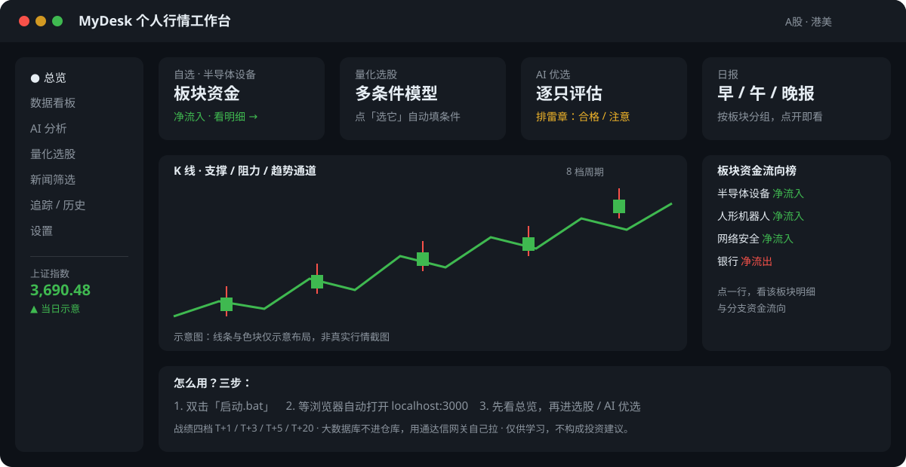

# MyDesk 个人行情工作台


帮你看行情、筛股票、做 AI 优选、看日报的个人工作台。
A 股为主，港美也能看。仅供个人学习与技术研究，**不构成任何投资建议**。

<p align="center">
  
</p>

> 上图是界面布局示意图，不是真实行情截图，帮你一眼看清这个工作台长什么样、每个区是干嘛的。

---

## 一眼看懂

- **看行情**：自选卡片、板块资金流向榜、K 线图（8 档周期）+ 支撑 / 阻力 / 趋势通道
- **选股票**：多条件量化模型，挑一条历史上比较稳的做法，点「选它」自动填好条件，再点「筛选」
- **AI 优选**：从筛选结果里帮你挑几只，讲清买卖点和风险，逐只盖「排雷」章：合格 / 注意 / 不合格
- **看日报**：早 / 午 / 晚报按板块分组，点开就是那个板块的报告
- **新闻筛选**：财联社电报按 9 个口子分流，只看你想看的那类消息

<p align="center">
  
</p>

---

## 快速开始

### 需要什么

- Node.js ≥ 20
- Windows 10 / 11（也可以在 Mac / Linux 上用命令行启动）
- AI 分析和智能助手需要你自己的模型接口；其他功能不需要 Key

### 三步启动

```bat
:: 1. 双击「启动.bat」
::    首次会自动装依赖，约 3~8 分钟，只此一次
:: 2. 脚本自动初始化、构建、启动服务
:: 3. 浏览器自动打开 http://localhost:3000
```

```bat
启动.bat            :: 正常启动
启动.bat rebuild    :: 改过代码后强制重新构建再启动
启动.bat prod       :: 生产模式，更稳定
启动.bat 3011       :: 换端口启动（3000 被占用时）
```

手动启动：

```bash
npm install
npx prisma generate
npx prisma db push --accept-data-loss
npx next dev -p 3000 --webpack
```

---

## 界面导航

| 菜单 | 能干什么 |
| --- | --- |
| 总览 | 自选行情卡片、刷新倒计时、常用入口 |
| 数据看板 | 板块资金流向榜（实时 / 历史 / 行业 / 概念 / 地域），点一行看明细 |
| AI 分析 | K 线 + 算法支撑 / 阻力 / 趋势通道 + 结构解读 / 关键价位 / 风险提示 |
| 量化选股 | 多条件模型 + AI 优选 + 排雷盖章 |
| 新闻筛选 | 财联社电报按 9 个口子分流，只展示，不产买卖信号 |
| 追踪 / 历史 | 交易计划、AI 分析存档 |
| 设置 | AI 接口配置、MCP 服务器管理、刷新周期 |

---

## 目录说明

> 先说一句实话：GitHub 文件列表右边那列是它固定显示的「最后一次提交文案」，改不了，
> 别人仓库也是这样。别人好看的做法不是改那一列，而是在 README 里把每个文件夹是干嘛的写清楚，
> 打开仓库先看 README 就知道，不用去猜提交文案。下面就是这个表。

| 文件夹 / 文件 | 是干嘛的 |
| --- | --- |
| `src/` | 全部程序代码，网站就是跑这里的东西 |
| `src/app/` | 页面和接口：打开的每个页面、每个 `/api/...` 接口都在这 |
| `src/components/` | 界面组件：图表、卡片、选股页、AI 分析页这些看得见的部件 |
| `src/lib/desk/` | 行情那一层：行情、交易日历、新闻、日报、板块这些逻辑 |
| `src/lib/quant/` | 量化那一层：选股、因子、AI 优选、影子版、战绩、回测这些逻辑 |
| `src/lib/llm/` | 模型通道：接哪个大模型、怎么发请求 |
| `scripts/` | 工具脚本：补数据、回测、体检、生成日报 PDF 这些一次性或定时跑的脚本 |
| `docs/` | 文档：数据来源、常见问题、项目介绍、能力清单都在这 |
| `data/` | 行情与板块快照（JSON），一部分是运行后生成的，不全入库 |
| `prisma/` | 数据库模型：表长什么样，存在哪张表 |
| `public/` | 静态资源：Logo、浏览器扩展 |
| `tests/` | 测试：改了代码跑一遍，看看有没有把旧功能弄坏 |
| `启动.bat` | Windows 上双击启动的脚本 |
| `package.json` | 依赖和启动命令：装什么包、怎么跑 |
| `.env.example` | 环境变量示例：只写名字不写真实 Key，照着填你自己的 |
| `README.md` | 就是你现在看的这篇：先讲能干什么、怎么启动 |

## 两件先说清楚的事

**1. 选股页里因子前面的 ⚠ 不是坏了。**
⚠ = 反转因子，历史上是反着走的：数值越高，之后几天反而越容易跌，命中它更接近「该回避」，
不是「该买入」。虚线 = 没通过历史检验，灰色 = 字段待实现、筛选时自动剔除。
完整口径在选股页顶部图例和 [`docs/数据来源.md`](docs/数据来源.md) 里。

**2. 数据从哪来，一句话版。**
实时行情走东财 / 腾讯 / 通达信，日 K 走通达信网关，新闻筛选走财联社电报，
公告走巨潮，港美走 Longbridge，AI 走你自己配的模型。
完整表格、每个接口的来源和留存时间，见 [`docs/数据来源.md`](docs/数据来源.md)。
仓库里不含任何 Key、数据库和运行时产物，克隆下来先照 `.env.example` 填你自己的配置。

---

## 详细文档

- 数据来源与接口：[`docs/数据来源.md`](docs/数据来源.md)
- 常见问题（启动、端口、自动扫描、数据会不会丢）：[`docs/常见问题.md`](docs/常见问题.md)
- 项目介绍与能力清单：`docs/项目介绍.md`、`docs/参考平台能力清单.md`

---

## 声明

本工具仅供个人学习与技术研究使用。行情数据来自公开接口，可能有延迟；
AI 输出由第三方模型生成，仅供参考，不构成任何投资建议。
请使用你自己的模型接口账号，并遵守其服务条款。
